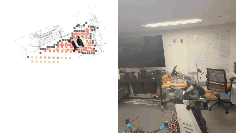

<div align="center">
<h1>FOUND-IT: Foundation-model-first Task-driven 3D Scene Graphs with Granularity on Demand</h1>
  <h1>FOUND-IT++: Scene Graph construction onboard a mobile manipulation robot</h1>

  <p>
    <strong>FOUND-IT</strong> 
    <a href="https://arxiv.org/abs/2605.25371">
      
    </a>
    <a href="https://www.youtube.com/watch?v=gaPeSTlYQKE">
      
    </a>
    &nbsp;&nbsp;&nbsp;&nbsp;
    <strong>FOUND-IT++</strong> 
    <a href="https://arxiv.org/abs/2610.23622">
      
    </a>
    <a href="https://www.youtube.com/watch?v=CtvftxgeKzg">
      
    </a>
  </p>

  <br />

  


</div>

---
# Table of Contents
* [Installation](#installation-of-found-it)
* [Jetson / NVIDIA Thor Setup](#jetson--nvidia-thor-setup)
* [Quick Start](#quick-start)
* [Real-time Streaming](#real-time-streaming)
* [Using different Geometric Foundation Models](#using-different-geometric-foundation-models)
* [Collecting Custom Data](#collecting-custom-data)
* [Adjusting Parameters](#adjusting-parameters)
* [Running Clio Semantic Evaluations](#running-clio-semantic-evaluations)
* [Multi-session Mapping](#multi-session-mapping)
* [Running Onboard a Robot](#running-onboard-a-robot)
* [Paper Citation](#citation)

---

# Installation of FOUND-IT

Note that the installation scripts install multiple repos which have their own licenses.

## Create and activate a new conda environment
conda create -n foundit python=3.11

conda activate foundit

## Make the setup script executable and run it
chmod +x setup.sh

./setup.sh

---

# Jetson / NVIDIA Thor Setup

This section covers extra steps required when running on a Jetson Thor. Only follow this section for a Jetson Thor.

<details>
<summary><strong>Show Jetson / NVIDIA Thor setup steps</strong></summary>


## Install torch and torchvision from the cu130 index

After running `setup.sh`, reinstall torch and torchvision from the CUDA 13.0 PyTorch index:

```bash
conda activate foundit

pip install torch==2.11.0+cu130 torchvision==0.26.0+cu130 \
    --extra-index-url https://download.pytorch.org/whl/cu130
```

Verify GPU is now detected correctly:

```bash
python -c "import torch; print(torch.cuda.get_device_name(0)); print(torch.version.cuda)"
# Expected: NVIDIA Thor  /  13.0
```

## Install perception_models without deps

`perception_models/requirements.txt` pins `numpy==2.1.2`, which conflicts with `sam3`'s `numpy<2` constraint. Install `perception_models` with `--no-deps` to skip the conflicting numpy pin — all required deps are already satisfied by the rest of the environment:

```bash
pip install -e ./perception_models --no-deps
```

`sam3` installs normally (it will downgrade `ftfy` from any newer version to `6.1.1`):

```bash
pip install -e ./sam3
```

Install these **in this order** (sam3 first, then perception_models with --no-deps) to avoid pip trying to satisfy the numpy conflict.

## Depth-Anything-3 deps unavailable on aarch64

`Depth-Anything-3/pyproject.toml` lists two packages with no aarch64 wheels:

- `pycolmap` — only used in `utils/export/colmap.py` (optional COLMAP export)
- `xformers` — only used as an optional SwiGLU backend in DINOv2 (falls back with a warning)

Comment both out before installing:

```toml
# "xformers",  # no aarch64 wheel; optional (DINOv2 SwiGLU falls back gracefully)
# "pycolmap",  # no aarch64 wheel; only used in optional COLMAP export utility
```

Then install normally:

```bash
pip install -e ./Depth-Anything-3
```

---

## Install sam3 as non-editable

`sam3` must be installed **without** the `-e` flag. Installing in editable mode causes `sam3.__file__` to be `None`, which breaks `pkg_resources.resource_filename` when it tries to locate the bundled BPE vocabulary file at runtime:

```
TypeError: expected str, bytes or os.PathLike object, not NoneType
```

The correct install command is:

```bash
pip install ./sam3   # no -e flag
```

## HuggingFace authentication (required for --run_os)

The `--run_os` flag loads the SAM3 model, whose checkpoint is hosted on the gated repo `facebook/sam3`. You must accept the terms and authenticate before first use:

1. Accept the model agreement at `https://huggingface.co/facebook/sam3`
2. Log in from the terminal:
   ```bash
   conda activate foundit
   python -c "from huggingface_hub import login; login()"
   ```
   Paste a token from `https://huggingface.co/settings/tokens` when prompted.

The checkpoint (~2 GB) will download automatically on first run.

## Verify the full import chain

```bash
python -c "
from torchvision import transforms
from vggt.models.vggt import VGGT
import perception_models
import sam3
print('OK')
"
```

If this prints `OK`, the environment is ready.

</details>

---

# Quick Start

run `python main.py --image_folder /path/to/image/folder --vis_map --use_omega --omega_checkpoint /path/to/vggt-omega-256-weights/vggt_omega_1b_256_text.pt --omega_resolution 256 --places --places_full --omega_seg checkpoints/omega_256_7.pt --metric --run_os` replacing the image path to your folder of images and omega_checkpoint to the location of VGGT-Omega weights for the 256 model. 
This will create a visualization in Viser which shows the incremental construction of the scene graph. 

Since we do not require known calibration, any folder of RGB images can be tested. For an example dataset, office_loop.zip can be downloaded from 
the [VGGT-SLAM 2.0](https://github.com/MIT-SPARK/VGGT-SLAM) repo.

# Real-time Streaming

Plug in a RealSense Camera and run the following:

`python main_realtime.py  --vis_map --lc_thres 0.65 --submap_size 8 --use_omega --omega_checkpoint /path/to/vggt-omega-256-weights/vggt_omega_1b_256_text.pt --omega_resolution 256 --omega_seg checkpoints/omega_256_7.pt --metric --run_os`

Wait for the terminal to start printing out keyframe numbers before moving the camera. It may take about a minute for all models to load.

# Using different Geometric Foundation Models

Each GFM was a different trained ground segmentation head for the places layer. Here we should example run scripts with each model that 
we currently support

## VGGT-Omega

This is the default model we used for FOUND-IT++ and is enabled with the flag --use_omega

`python main.py --image_folder /path/to/image/folder --vis_map --use_omega --omega_checkpoint /path/to/vggt-omega-256-weights/vggt_omega_1b_256_text.pt --omega_resolution 256 --places --places_full --omega_seg checkpoints/omega_256_7.pt --metric --run_os`

## VGGT

Here, we can use loop closure verification developed from VGGT-SLAM 2.0 and thus relax the threshold for SALAD image retrieval. 

`python main.py --image_folder /path/to/image/folder --vis_map --lc_thres 0.95 --submap_size 16 --places --places_full --metric --run_os`


## Depth Anything Large

`python main.py --image_folder /home/dominic/cam_ws/imgs/cubicle/images  --vis_map --lc_thres 0.65 --submap_size 16 --places --places_full --metric --run_os --use_da --da_seg checkpoints/large_seg_17.pt --da_model depth-anything/DA3-LARGE-1.1`

## Depth Anything Giant

`python main.py --image_folder /home/dominic/cam_ws/imgs/cubicle/images  --vis_map --lc_thres 0.65 --submap_size 16 --places --places_full --run_os --use_da --da_seg checkpoints/giant_layer_28.pt --da_model depth-anything/DA3NESTED-GIANT-LARGE-1.1`

# Collecting Custom Data

To quickly collect a test on a custom dataset, you can record a trajectory with a cell phone and convert the MOV file to a folder of images with:

mkdir <desired_location>/img_folder

ffmpeg -i /path/to/video.MOV -vf "fps=10" <desired_location>/img_folder/frame_%04d.jpg

# Adjusting Parameters

Run `--help` to view all parameters. Common parameter shared by main.py (offline), main_realtime.py (for running in 
real-time with a RealSense camera), and main_ros2.py (for running onboard a robot for autonomous operation) can be found in 
foundit/app_setup.py

By default, we run a sparse point cloud for the overall map. This improves runtime, especially when using the places layer. To generate 
a dense map, set `--voxel_size -1`.

The places layer can be turned off by omitting `--places` and the objects layer can be turned off by omitting `--run_os`.


---


# Running Clio semantic evaluations

To run each of the Clio scenes, download the datasets from [Clio](https://github.com/MIT-SPARK/Clio) and use the following commands. Replace the corresponding path to your location of the Clio datasets. Note that changes to the code during the preparation for release may result in numbers 
not matching exactly what was reported in the paper. We also only include the FOUND-IT++ code here.

export CLIO_DIR=/home/dominic/cam_ws/clio_datasets

## Office
python main.py --image_folder $CLIO_DIR/office/images/ --max_loops 0 --submap_size 16 --colmap_path $CLIO_DIR/office/sparse/0/ --vis_map --run_os --min_disparity 0 --depth_folder $CLIO_DIR/office/depth/ --colmap_scale 2.10 --top_k 32 --log_os --log_results
python scripts/eval_clio.py --scene office

## Apartment
python main.py --image_folder $CLIO_DIR/apartment/images/ --max_loops 0 --submap_size 16 --colmap_path $CLIO_DIR/apartment_full/sparse/0/ --log_results --vis_map --run_os --log_os --min_disparity 0 --depth_folder $CLIO_DIR/apartment_full/depth/ --colmap_scale 0.638 --top_k 32
python scripts/eval_clio.py --scene apartment

## Cubicle
python main.py --image_folder $CLIO_DIR/cubicle/images/ --max_loops 0 --submap_size 16 --colmap_path $CLIO_DIR/cubicle/sparse/1 --log_results --run_os --log_os --min_disparity 0 --depth_folder $CLIO_DIR/cubicle/depth/ --colmap_scale 0.3527 --top_k 32
python scripts/eval_clio.py --scene cubicle

# Multi-session mapping

To start session one, run the following (real-time model with a realsense plugged in):

`python main_realtime.py  --vis_map --lc_thres 0.65 --submap_size 8 --use_omega --omega_checkpoint /home/dominic/Downloads/vggt_omega_1b_256_text.pt --omega_resolution 256 --omega_seg checkpoints/omega_256_7.pt --metric --run_os --voxel_size -1 --metric --save_session m1`

After mapping is finished, press the button `Cancel Session` in Viser to save the session. 

To start mapping session two, run the following, where now we load the saved session from session one. Once a loop closure has been established, there 
will be a consistent map in Viser between the two sessions.

`python main_realtime.py  --vis_map --lc_thres 0.65 --submap_size 8 --use_omega --omega_checkpoint /home/dominic/Downloads/vggt_omega_1b_256_text.pt --omega_resolution 256 --omega_seg checkpoints/omega_256_7.pt --metric --run_os --voxel_size -1 --metric --load_session m1`

# Running onboard a robot

The additional code (such as grasping) needed to run onboard a AgileX Cobot Magic robot with Nero arm can 
be found [here](https://github.com/MIT-SPARK/FOUND-IT_robot)

# Acknowledgement

This work was supported in part by the NSF Graduate Research Fellowship
Program under Grant 2141064 and by Samsung Research America.

# Citation

If our code is helpful, please cite our papers as follows:

```
@article{maggio2026foundit,
  title={{FOUND-IT}: Foundation-Model-First Task-Driven {3D} Scene Graphs With Granularity on Demand},
  author={Maggio, Dominic and Gorlo, Nicolas and Hauser, Kris and Carlone, Luca},
  journal={IEEE Robotics and Automation Letters},
  year={2026},
}
```

```
@article{maggio2026founditpp,
  title={Foundation-Model-Driven 3D Scene Graphs for Mobile Manipulation},
  author={Maggio, Dominic and Shaikewitz, Lorenzo and Naveen, Aryan and Hauser, Kris and Carlone, Luca},
  journal={arXiv preprint arXiv:2610.23622},
  year={2026}
}
```
